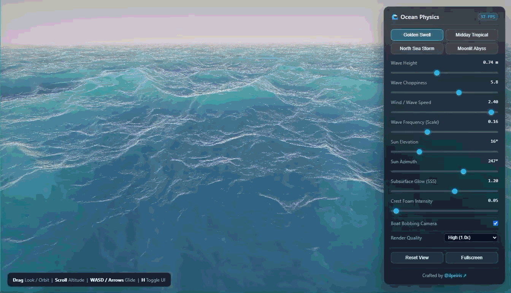

# 🌊 Ocean Waves (WebGL2 & GLSL)


A real-time, interactive **3D photorealistic ocean wave simulation** packed into a **single `.html` file** with zero external libraries, textures, or build steps. Everything from wave geometry and crest foam to subsurface scattering and atmospheric twilight is computed procedurally on the GPU using raw **WebGL2** and **GLSL heightfield raymarching**.

###  **[Launch Live Interactive Demo](https://ilpeiris.github.io/ocean-sandbox/)**


  

---

## ✨ Features

* **Zero Dependencies, Single File:** No `npm`, no bundlers, no external 3D engines, and no image textures. Open `index.html` in any modern browser and it runs immediately even offline.
* **Multi-Octave Trochoidal Wave Spectrum:** Combines 7 geometric octaves for raymarched wave displacement with 13 high-frequency octaves for micro-surface capillary normals.
* **Subsurface Scattering (SSS):** Backlit wave crests glow with realistic emerald/turquoise light transmission when looking toward the sun.
* **Physical Water Optics:**
  * Schlick's Fresnel equations ($\text{IOR} = 1.333$) blending deep-water absorption with sky reflection.
  * Dual-lobe microfacet solar specular glints (tight sun path + broad surface shimmer).
  * Local Jacobian curvature detection for procedural whitecaps and lacy crest foam.
* **Dynamic Rayleigh & Mie Atmosphere:** Real-time sky gradients, solar disk, horizon mist, and ACES filmic tone mapping that respond dynamically to sun elevation and azimuth.
* **Interactive Physics & Lighting Sandbox:** Tweak wave height, choppiness, wind speed, frequency, sun angles, subsurface glow, foam intensity, and render resolution scale in real time.

---

## 🎮 Controls

| Input | Action |
| :--- | :--- |
| **Left-Click + Drag** | Look around $360^\circ$ in 3D space |
| **Scroll Wheel** | Adjust camera altitude above the water ($1.4\text{ m}$ to $28\text{ m}$) |
| **W / A / S / D** or **Arrow Keys** | Glide across the ocean surface |
| **H Key** | Hide / show the UI control panel (for clean recordings or wallpapers) |
| **Environment Presets** | Switch between *Golden Swell*, *Midday Tropical*, *North Sea Storm*, and *Moonlit Abyss* |

---

## 🚀 Quick Start

Because the entire project is self-contained in a single file, you don't need a local web server or Node.js:

```bash
git clone https://github.com/ilpeiris/ocean-sandbox.git
cd ocean-sandbox
```

Then simply double-click **`index.html`** to open it in Chrome, Firefox, Edge, or Safari.


---

## 🛠️ How to Use This in Your Own Projects

You don't just have to look at the sandbox, you can drop this ocean directly into your own websites, landing pages, or graphics projects in three ways:

### 1. Drop-In Interactive Hero Background (`<iframe>`)
Because the entire simulation is a single file, the easiest way to use it as a full-screen background on a portfolio or landing page is via a background `<iframe>`:

1. Open `index.html` and add the `hidden` class to the control panel so only the water renders:
   ```html
   <div id="ui-container" class="hidden">
   ```
   *(Optional: also delete or hide `<div id="hud-help">` right below it).*
2. Embed it behind your website's hero section:
   ```html
   <div style="position: relative; width: 100%; height: 100vh; overflow: hidden;">
     <iframe 
       src="ocean.html" 
       style="position: absolute; inset: 0; width: 100%; height: 100%; border: 0; z-index: 0;"
       loading="lazy">
     </iframe>
     <div style="position: relative; z-index: 1; pointer-events: none;">
       <!-- Your website title / content here -->
     </div>
   </div>
   ```

### 2. Design Your Own Preset in the UI & Hardcode It
Use the live sliders in the browser to dial in the exact wave height, choppiness, sun angle, and foam for your scene, then copy those numbers into the `state` object in `index.html` (around line 395) so your project loads with your exact mood by default:

```javascript
const state = {
  seaHeight: 0.85,      // Your custom wave height
  seaChoppy: 5.0,       // Your custom choppiness
  seaSpeed: 1.10,       // Your custom wind speed
  seaFreq: 0.15,        // Your custom wave scale
  sunElevation: 8,      // Golden hour sun height (degrees)
  sunAzimuth: 200,      // Sun compass direction (degrees)
  sssIntensity: 1.3,    // Emerald crest glow
  foamIntensity: 1.1,   // Whitecap intensity
  // ...
};
```

### 3. Extract the GLSL Shader for Three.js / Custom Engines
If you are building a game or 3D web app in **Three.js**, **Babylon.js**, or **Raw WebGL2**, you can copy `fragmentShaderSource` directly into a `ShaderMaterial` or post-processing pass. Simply pass the required uniforms (`uResolution`, `uTime`, `uCamPos`, `uCamTarget`, and the wave parameters) on each `requestAnimationFrame` tick.


---

## 🧠 How It Works Under the Hood

1. **Full-Screen Quad & Ray Setup:** A minimal vertex shader emits a 4-vertex screen-aligned triangle strip using `gl_VertexID`, passing camera basis vectors (`uCamPos`, `uCamTarget`, `uCamRoll`) to the fragment shader.
2. **Bisection Heightfield Raymarching (`traceOcean`):** For every pixel pointing below the horizon, the fragment shader marches a ray through a 7-octave trochoidal heightfield (`mapGeometry`) using secant/bisection refinement to locate the water surface intersection accurately in just 10 steps.
3. **Multi-Scale Normal & Curvature Evaluation (`getNormal`):** Once the ray hits the surface, a 13-octave evaluation (`mapDetailed`) samples neighboring points with distance-adaptive epsilon filtering to compute both the micro-surface normal and a second-derivative crest curvature term.
4. **Physical Shading & Tone Mapping (`shadeOcean`):** The surface normal drives Fresnel sky reflection, subsurface crest scattering, dual-lobe Blinn-Phong solar specular highlights, and curvature-driven foam before passing through an exponential horizon fog blend and ACES filmic tone curve.

---

## 🙏 Credits & Attribution

* The core trochoidal wave octave formulation (`seaOctave`) and bisection heightfield raymarching approach are inspired by **Alexander Alekseev's (TDM)** classic [*"Seascape"*](https://www.shadertoy.com/view/Ms2SD1) shader on Shadertoy.
* Extended into a standalone WebGL2 application with interactive 6-DOF camera physics, real-time uniform controls, curvature-based crest foam, enhanced subsurface scattering, and multi-preset atmospheric lighting.


---

## 👤 Author


**M.D. Isuru Lakmal Peiris**
* GitHub: [@ilpeiris](https://github.com/ilpeiris) Feel free to star the repo if you find it useful or use it in your projects!
* LinkedIn: [linkedin.com/in/ilpeiris](https://linkedin.com/in/ilpeiris)

---

## 📄 License

Released under the **MIT License**. Feel free to use, modify, and embed this simulation in personal, educational, or commercial projects. See [LICENSE](LICENSE) for details.


